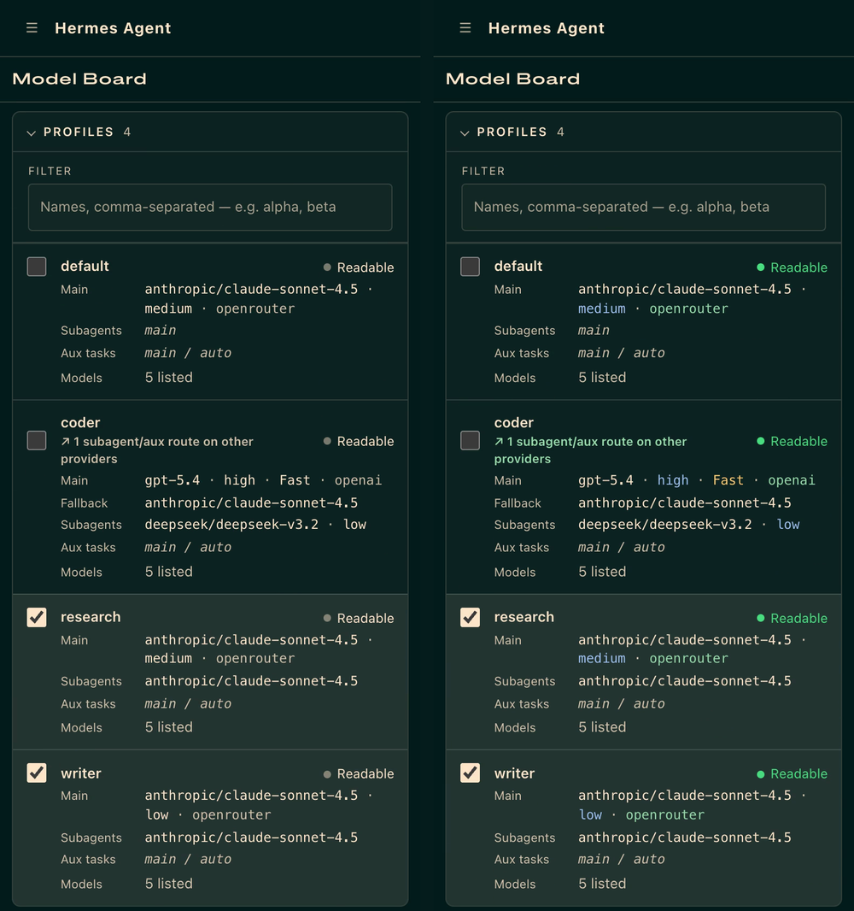

# Fleet Control

Phone-first bulk model settings for **Hermes Agent**, by **driptothebone**.

Fleet Control grew out of **Model Board**, my Hermes plugin hackathon entry.
This repository holds both. The entry as submitted is tagged
[`hackathon-submission`](https://github.com/driptothebone/fleet-control/tree/hackathon-submission)
(commit `17de6b8`).

See every profile's models at a glance, tick several profiles and change their
main model, subagents, auxiliary tasks, reasoning effort, Fast mode, fallback
chain or subagent limit together. Nothing is saved until you review the exact
changes and explicitly confirm.



*Phone view with synthetic demo profiles. The left side shows the Nous Blue light theme with Colour off, which is the default. The right side shows Hermes Teal with Colour on.*

## Install

Requires Hermes **0.23.0 or later** with its browser dashboard, the local-file
config backend and **in-process** plugin loading. Separate plugin-host
isolation and remote config are not supported. Profile-scoped tickets are
refused. Do not weaken an existing isolation policy to enable this plugin.

```sh
hermes plugins install https://github.com/driptothebone/fleet-control
hermes plugins enable fleet-control
```

Restart the Hermes dashboard so it discovers the plugin, then open **Fleet Control**.
If you have the hackathon `hermes-model-board` installed, you can disable it.
The two use different plugin ids and do not conflict.

The plugin adds its own state, preview and apply API routes inside the existing
authenticated Hermes dashboard. It does not start a separate server or open a
port. On a phone, reach it through the dashboard's existing authenticated
HTTPS or Tailscale access.

## Other machines (optional)

One board can also show and change profiles on your other machines, for
example a Linux box you reach over Tailscale. It is off until you fill in a
machine slot. With no machine configured, Fleet Control makes no outbound calls
and works exactly as a single-host board.

Fleet Control does not install anything on the other machine. It calls that
machine's own Hermes dashboard over the same public routes it uses locally, so
every save on that machine goes through that machine's Hermes.

1. On the other machine, run its normal Hermes dashboard with a dashboard
   session token and reach it over your tailnet. One way is
   [Tailscale Serve](https://tailscale.com/kb/1312/serve) in front of a loopback
   dashboard.

   ```sh
   # on the other machine
   hermes config set dashboard.public_url https://linux-box.your-tailnet.ts.net
   TOKEN="$(openssl rand -hex 32)"
   echo "$TOKEN"    # copy this, step 2 needs it
   tailscale serve --bg 9119
   HERMES_DASHBOARD_SESSION_TOKEN="$TOKEN" \
     hermes dashboard --host 127.0.0.1 --port 9119 --no-open
   ```

   Hermes's dashboard guide describes this token-only setup under
   "Deployment session-token provider". Start the dashboard with the same
   token every time, or the board's saved copy stops working.

2. On the machine that runs the board, fill in a slot in the plugin's settings
   (Desktop **Settings, Plugins, Fleet Control**, which masks the token) or
   with the CLI, which leaves the token in your shell history.

   ```sh
   hermes config set plugins.entries.fleet-control.settings.machine_1_label "Linux box"
   hermes config set plugins.entries.fleet-control.settings.machine_1_url https://linux-box.your-tailnet.ts.net
   hermes config set FLEET_CONTROL_MACHINE_1_TOKEN <the token from step 1>
   ```

   There are four slots (`machine_1` to `machine_4`). `local_label` names this
   machine on the board. Reload the board. Changes apply without restarting
   the dashboard.

Addresses must use `https://`. Plain `http://` is accepted only for loopback,
Tailscale addresses (`100.64.0.0/10`, `fd7a:115c:a1e0::/48`) and `*.ts.net`
names. Anything else is refused with a reason and never contacted.

How it behaves.

- Each profile is named by its machine and its name, so `alpha` on the Mac and
  `alpha` on the Linux box are different rows. A **machine filter** and machine labels
  appear only once another machine is configured.
- Each preview and Apply stays on one machine. A selection that spans machines
  is refused before anything is written. A preview made for one machine
  cannot be applied on another.
- A machine that does not answer, refuses the token or answers with a redirect
  is shown as offline, sign-in refused or address refused. Its profiles are
  hidden until it answers. The other machines keep working.
- If a save on another machine loses its answer on the way back, that profile
  is reported as uncertain. It is never retried or replayed. Reload to see
  what was saved.

## What it does

- **Overview** shows profiles, readable configs, profiles that route some tasks
  to other providers and a main-model breakdown.
- **Change several** works on All shown or Ticked profiles. A scope line always
  names exactly which profiles the next preview will change, including ticked
  profiles hidden by the filter.
- **Settings** cover the main model, main plus subagents together, subagents
  (a specific model or the same as main), all auxiliary tasks (specific, same
  as main or automatic), main reasoning effort, Fast or Normal, max subagents at
  once (1 to 16) and an ordered fallback chain of up to ten entries that you can
  add to, reorder, remove from or clear.
- **Per profile** editing opens any profile to change its settings or
  individual auxiliary tasks.
- **Review** uses plain labels such as "Main model model-a to model-b" with the
  exact config fields and values one click away, then one explicit confirmation
  and a single Apply. Results show what was saved, read back field by field.
- **Looks native** by following the active dashboard theme, dark or light, live.
  A **Colour** switch (off by default) colour-codes models, providers, values
  and status. Your browser remembers the choice.

## Safety and disclosures

- No direct `.env`, `auth.json`, CLI login or other credential-store reads. Model
  choices come through Hermes's own model-options route. Hermes owns credential
  handling and may refresh or probe provider catalogues. A listed model is not
  proof of login, entitlement or that it will answer.
- Reads and saves every profile only through Hermes's public dashboard routes,
  the same ones its own Config and Models pages use. Main model changes go
  through Hermes's own model switch, which validates the choice and may ask
  for a cost confirmation first. The board never imports Hermes internals and
  never returns whole configurations or credential or endpoint fields.
- Exact preview, explicit confirmation, expiring single-use preview tokens,
  stale-state rejection and saved-field readback. If a profile changed after the
  preview, Apply is refused and nothing is written. Recovery reloads and makes a
  fresh, unconfirmed preview. Apply is never retried or replayed automatically.
- Saves profiles one at a time and rechecks each one right before saving it.
  Hermes has no conditional save yet
  ([hermes-agent#156100](https://github.com/NousResearch/hermes-agent/issues/156100)),
  so a change that lands in that same instant is not caught. **Not a fleet
  transaction, rollback system or cross-process lock.** Partial or uncertain
  outcomes are reported per profile.
- Hermes's file backend rewrites a profile's config when saving, which drops
  YAML comments. Keep comments elsewhere if they matter to you.
- Does not start or restart gateways, switch running chat sessions, launch
  models, execute shell commands, install dependencies, add telemetry or
  self-update. Saved settings apply to future sessions.
- Changing a model within the same provider keeps that route's endpoint and auth
  settings untouched. On subagent and auxiliary routes, changing provider clears
  only the previous provider's own standard API address. The review masks the
  endpoint value. Custom endpoints, auth overrides,
  malformed or legacy fallback entries, profiles with external secret sources
  and unsupported task-effort combinations are refused or shown read-only with a
  reason. They are never silently changed or carried across providers.
- Fast is offered only where Hermes's model catalog says the model and provider
  support it. On a custom endpoint it shows why it can't be verified instead.
  Whether your account is entitled to Fast is not something the plugin can know.
- Not included are jobs, federation, login or refresh tooling.
- **Other machines (only if you configure them).** The board then makes
  outbound HTTPS (or loopback/Tailscale HTTP) calls to the Hermes dashboards
  you listed and nowhere else. Redirects are not followed and proxy settings
  from the environment are not used, so a token is only sent to the address you
  entered. Each machine's dashboard token is stored by Hermes in your `.env`
  (as `FLEET_CONTROL_MACHINE_<n>_TOKEN`) and read through Hermes's documented
  secret API. That token grants **full dashboard access** to that machine, so
  treat it like a password. Tokens, addresses and endpoint values are never
  sent to the browser.

## Compatibility and verification

Version 2.1.0 was exercised on an unmodified Hermes v0.23.0 checkout (commit
`2bd378e`) with synthetic profiles and an offline host. Hermes discovered and
mounted the plugin itself from a profile's plugins folder. The run covered
dashboard authentication, combined subagent, effort, max subagents and Fast
saves across two profiles, inherit routes, auxiliary routes and efforts,
fallback chains, a main model switch through Hermes's model route and no-op
saves. Stale previews, replayed tokens, unconfirmed saves, Fast on a custom
endpoint and profiles with external secret sources were refused. Unticked
profiles were left unchanged and no endpoint value reached the browser.

Version 2.2.0 adds other machines. It was exercised on the same pristine
Hermes checkout with a synthetic main dashboard and two token-locked synthetic
remote dashboards on loopback. The checks covered these cases.

- the same profile name on two machines
- preview, confirm, save and file readback on a remote profile
- a selection across machines refused before any write
- a wrong token, a stopped machine and a redirect
- a lost save answer reported as uncertain and not replayed
- stale previews
- an http address outside the tailnet refused without being contacted

With no machine configured, every board response matched 2.1.0. It has not yet
been tried across a real tailnet.

The browser interface with no other machine configured is unchanged from
2.0.0. Its earlier checks covered theme integration in Midnight, Hermes Teal, Mono, Ember and Nous Blue (light) at
390 px phone and desktop widths. Screenshots here use **synthetic profiles**.

Hermes's admission validator passes. The plugin imports only `hermes_constants`,
`hermes_yaml.safe_load`, `hermes_cli.config.load_config_readonly` (to read its
own settings) and `agent.secret_scope.get_secret` (to read machine tokens) from
Hermes, all on the published plugin API list.
The 0.23.0 validator's older list still flags `hermes_yaml.safe_load`, while
current Hermes lists it.

## License

MIT. Copyright (c) 2026 driptothebone.
